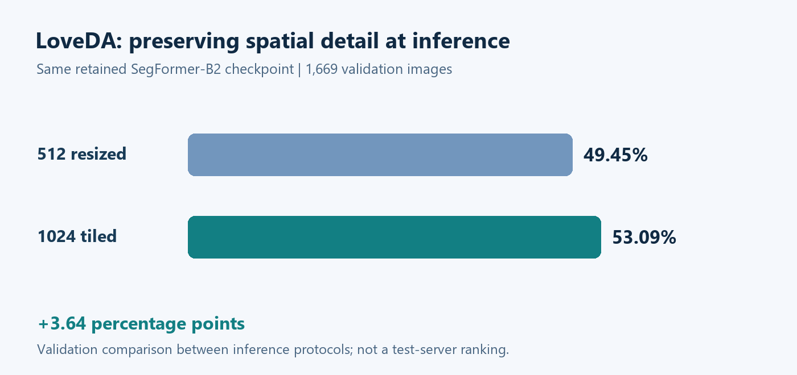
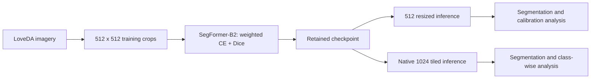
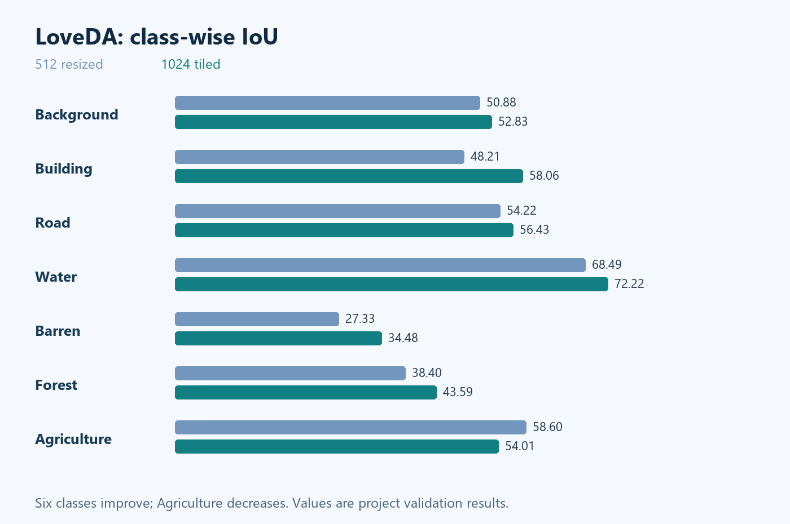

# Trustworthy Remote Sensing for Land-Cover Mapping
### Resolution-Aware Segmentation and Confidence Calibration on LoveDA

**Mehedi Hasan**

**SegFormer-B2 · Seven land-cover classes · 1,669 validation images**

[Results](#validation-results) · [Class analysis](#class-wise-validation-iou) · [Experiment scope](#what-the-experiments-establish) · [Code availability](#code-availability)

## Overview

This project studies how training, spatial resolution, inference strategy, and confidence calibration affect urban and rural land-cover segmentation. The pipeline uses **SegFormer-B2**, weighted cross-entropy plus Dice training, and overlapping tiled inference on the LoveDA dataset.

**Research status:** ongoing experimental project. No accepted paper or public test-server result is claimed. The documentation records the project validation results supplied on November 10, 2026; it is not an independently rerun benchmark release.

## Approach

1. Validate image and mask loading, class handling, training, and evaluation with quick runs.
2. Fine-tune SegFormer-B2 using **512 × 512 crops**, augmentation, mixed precision, and source-selection monitoring.
3. Evaluate confidence using temperature scaling, expected calibration error (ECE), negative log likelihood, and Brier score.
4. Compare resized inference with overlapping **512 × 512 tiles on native 1024 × 1024 images**.
5. Inspect class-wise gains and losses rather than relying on mIoU alone.

## Validation results

| Protocol | Validation images | mIoU (%) |
| --- | ---: | ---: |
| Entire images resized to 512 × 512 | 1,669 | 49.45 |
| Native 1024 × 1024 images; overlapping 512 × 512 tiles | 1,669 | **53.09** |

**Absolute improvement: 3.64 percentage points.** Both values refer to the retained trained checkpoint evaluated using different inference protocols. Additional continuation fine-tuning did not improve the checkpoint-selection score, so the original checkpoint was retained.

The two protocols use different pixel grids. This comparison demonstrates the effect of the overall inference protocol; it does not isolate the effects of resolution and overlap averaging. It is not evidence that additional fine-tuning improved the model.

The measured project values above take precedence over preliminary or reference numbers that may appear in earlier CV drafts. Published methods are not presented as personally reproduced baselines.

## Class-wise validation IoU

| Class | 512 resized (%) | 1024 tiled (%) |
| --- | ---: | ---: |
| Background | 50.88 | 52.83 |
| Building | 48.21 | 58.06 |
| Road | 54.22 | 56.43 |
| Water | 68.49 | 72.22 |
| Barren | 27.33 | 34.48 |
| Forest | 38.40 | 43.59 |
| Agriculture | **58.60** | 54.01 |

Six classes improve under tiled inference, while Agriculture decreases. The figures visualize recorded metrics; they are not simulated prediction maps. Small discrepancies between differences calculated from rounded entries and any earlier unrounded summaries should be resolved from the original evaluation outputs.

## Calibration

Temperature scaling reduced ECE from **11.21% to 2.85% under the 512 × 512 resized protocol**. These calibration measurements do not transfer automatically to the final tiled protocol. Temperature scaling changes confidence estimates without changing the per-pixel argmax labels.

## What the experiments establish

- Full training was completed for B2 with weighted CE + Dice. Quick B0/CE and B2/CE runs establish pipeline operation, not matched full-training superiority.
- Preserving native-resolution detail through tiled inference improved the reported validation mIoU for the retained checkpoint.
- Additional targeted continuation training did not produce the selected improvement.
- Calibration and segmentation accuracy answer different questions; tiled-protocol calibration remains to be evaluated.
- Urban-to-rural and rural-to-urban source-only experiments require their own separately reported, locked protocols before domain-generalization claims can be made.

## Next evaluation steps

Complete the matched full B2 cross-entropy baseline; compare resized, non-overlapping, and overlapping inference at a common output grid; inspect Agriculture confusion; and measure calibration under the final tiled protocol. Dataset split manifests, checkpoint hashes, tile stride, blending, and test-time augmentation settings should accompany a reproducible code release rather than being inferred from these summary metrics.

## Repository contents

| Path | Contents |
| --- | --- |
| `assets/` | Charts of recorded validation metrics and figure provenance |
| `results/inference.csv` | Overall inference comparison |
| `results/class-iou.csv` | Class-wise validation IoU |

## Code availability

**Code will be available upon acceptance of the associated paper.** The project is currently under development; no paper acceptance or submission is implied. Source notebooks, checkpoints, and executable evaluation scripts are not yet included in this documentation release.

## Resources

- [LoveDA dataset and benchmark](https://github.com/Junjue-Wang/LoveDA)
- [SegFormer](https://github.com/NVlabs/SegFormer)

LoveDA and SegFormer are third-party resources credited to their original authors. Access and use remain subject to their respective terms.

[Research profile](https://github.com/mhasan96) · [Website](https://sites.google.com/view/i-am-mehedi) · [Contact](mailto:hasanme1@msu.edu)
